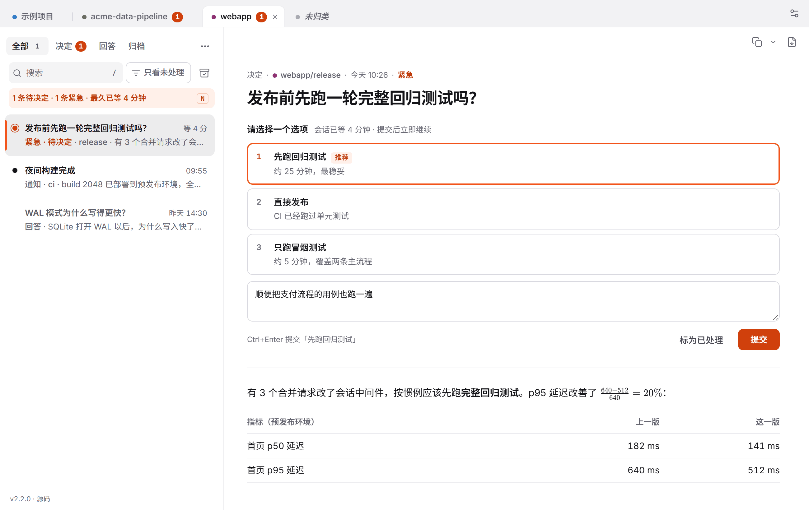

# ClaudeDesk

[](https://github.com/tsljgj/ClaudeDesk/actions/workflows/build.yml)
[](https://github.com/tsljgj/ClaudeDesk/releases/latest)
[](LICENSE)


English · [中文](README.zh-CN.md)

ClaudeDesk is a small Windows tray app that gives Claude Code sessions a place to reach you outside the terminal. Instead of the built-in AskUserQuestion prompt, a session posts a **decision** with options and waits in the background; you pick an option and add a note on your desktop, and the session wakes up and carries on. When you ask a session something, it also posts the question and the full **answer** here, so it doesn't get buried under tool output, and you can ask **follow-up questions** from the same place. Occasional **notices** ("the long run finished", "a job crashed") land here too.

<picture>
  <source media="(prefers-color-scheme: dark)" srcset="docs/screenshot-dark.png">
  
</picture>

> Third-party tool, not affiliated with or endorsed by Anthropic. The interface is in Simplified Chinese.

## Contents

- [Features](#features)
- [Install](#install)
- [Quick start: connect Claude Code](#quick-start-connect-claude-code)
- [Everyday use](#everyday-use)
- [Keyboard shortcuts](#keyboard-shortcuts)
- [CLI reference (`desk.py`)](#cli-reference-deskpy)
- [How it works](#how-it-works)
- [Data files](#data-files)
- [Self-update](#self-update)
- [Security and privacy](#security-and-privacy)
- [Build from source](#build-from-source)
- [Contributing](#contributing)
- [License](#license)

## Features

- **Decisions with a reply box.** Options with descriptions and a recommended pick, plus a free-text note on every decision. The waiting session gets your choice as one line of JSON.
- **Answers and follow-ups.** Answers keep your original question. Ask a follow-up on any answer, notice or handled decision; a session that is listening answers it and the reply is linked back.
- **Knows where each session is.** Every message remembers the Claude Code session that posted it. Cards say whether that session is waiting, still open but not listening, or ended, and when your reply reached it. One background listener per session brings replies and follow-ups back in a single batch.
- **One tab per repo.** Messages are grouped by the git repo the session runs in. Tabs can be closed and reopened; a closed tab comes back by itself when that repo posts again.
- **Built for triage.** A waiting-decisions strip with `N` to jump to the next one, an "unhandled only" filter (`F`), mark handled (`R`) for any selection, one-click archive of everything handled, undo (`Z`), keyboard multi-select.
- **Full Markdown.** Tables, highlighted code and LaTeX math (`$…$`, `$$…$$`, `\(…\)`, `\[…\]`), rendered offline with bundled fonts. Copy any message as Markdown, rich text or plain text, or export it to PDF.
- **Hard to miss, easy to ignore.** Windows notifications, a tray badge and a taskbar badge with the unread count; urgent decisions keep flashing until you look.
- **Light, dark or system theme**, four accent colors, sans or serif reading font, three text sizes, three reading widths, two list densities.
- **Small and local.** One exe, a stdlib-only CLI, plain JSONL files next to it. No account, no telemetry. It updates itself from GitHub Releases.

## Install

Windows 10 or 11 (Edge WebView2 is built in).

1. Download `ClaudeDesk.exe` from [Releases](https://github.com/tsljgj/ClaudeDesk/releases/latest) into a folder you can write to, e.g. `%LOCALAPPDATA%\Programs\ClaudeDesk\`. Not `Program Files`, or it can't update itself.
2. Run it. It puts `desk.py` (the CLI that Claude uses) and `data\` (your inbox) next to itself and sits in the tray.
3. Connect Claude Code (next section).

Upgrading from 1.x: quit the old app from the tray and drop the new `ClaudeDesk.exe` into the old folder. `data\` carries over; the old `_internal\` folder can be deleted.

> Windows 11 hides new tray icons under "^". To keep it visible: Settings → Personalization → Taskbar → Other system tray icons → turn on ClaudeDesk.

## Quick start: connect Claude Code

1. Copy [`skill/claude-desk/SKILL.md`](skill/claude-desk/SKILL.md) to `~/.claude/skills/claude-desk/SKILL.md`.
2. Near the top of that file, the line that defines `desk` reads `python C:/path/to/ClaudeDesk/desk.py`. Replace it with your Python 3.10+ and the `desk.py` next to your `ClaudeDesk.exe`.
3. Optionally make it a standing rule for every session in `~/.claude/CLAUDE.md`:

   ```markdown
   ## Talking to the user: ClaudeDesk
   - For anything the user must decide, don't use AskUserQuestion: post a decision with skill claude-desk. The session's one background `desk.py listen` brings the reply back.
   - When answering a user's question, answer in the chat, then post it to ClaudeDesk as an answer with `--question-from-chat --body-from-chat`.
   ```

The skill is written in Chinese, to match the UI. Claude follows it either way, and the commands are the same.

### How sessions use it

- **No setup per session.** `desk.py post` records the Claude Code session it runs in (Claude Code sets `CLAUDE_CODE_SESSION_ID` and `CLAUDE_PID` for every command) and the git repo. Replies and follow-ups are routed back to that session; `--source` is optional and only a display name.
- **One background `listen` per session.** When `post` reports on stderr that no listener is running, the session starts `desk.py listen` in the background with no timeout. It returns once with everything that has arrived for the session (your replies to its decisions, your follow-ups on its messages), one JSON line each. The session handles the whole batch and starts `listen` again. A second `listen` for the same session exits at once. Subagents share their session's id and don't run one.
- **Answers are written once.** The session writes the answer in the chat and, in the same message, runs `desk.py post --kind answer --title "…" --question-from-chat --body-from-chat`. `desk.py` copies your question and the answer from the session's transcript, so Claude never writes the answer a second time.
- **Ended sessions don't lose anything.** Replies and follow-ups for a session that has ended are kept. A new session in the same repo sees them with `desk.py status` / `desk.py inbox` and takes them over with `desk.py inbox --adopt`.

### Why it's efficient

Every time a background command finishes, Claude Code wakes the session, and each wake re-reads the session's whole context (cheap while the prompt cache is warm, expensive once it has expired). So ClaudeDesk keeps wakes and tokens down:

- **One listener per session.** Not one `wait` per decision plus a follow-up listener: one `listen` per session, so N answered decisions don't mean N wakes.
- **Batched wakes.** Replies and follow-ups that arrive close together (each within 1.5 s of the last, up to 6 s) come back in one wake. Answer three decisions in a row and the session wakes once.
- **No second copy of answers.** `--body-from-chat` copies the answer from the transcript instead of having Claude write it again into a file. Output tokens are the expensive ones.
- **No polling.** Sessions never loop over `list` or `responses`. `listen` checks the data files' sizes once a second and reads them only when they change; each event is one short JSON line without message bodies.
- **Nothing wakes a session twice.** A duplicate `listen` exits at once, and a `listen` whose session has ended exits silently instead of taking events nobody will read.

## Everyday use

### Window and tray

| What | How |
|---|---|
| Open | Run `ClaudeDesk.exe` or click the tray icon. Running it again only brings the window to the front |
| Close | × only hides the window to the tray; messages keep arriving. Quit from the tray menu |
| Start with Windows | Settings or the tray menu (writes `HKCU\…\Run`; starts in the tray) |
| Tray icon | Red number = unread messages; red dot = nothing unread but a decision is still open; flashing = a decision or urgent message you haven't seen |
| Taskbar button | While the window is open or minimized it carries the same red badge. When a message arrives with the window in the tray, a minimized button appears with the badge and flashes: decisions and urgent messages until you look or they are handled elsewhere, others three times |

New messages also raise a Windows notification; clicking it opens that message.

### Repo tabs

- The tabs across the top are **全部项目** (all repos) followed by one tab per repo, sorted by name. The repo comes from `desk.py post`, which records the git repo of the directory it runs in (the origin URL's name; worktrees resolve to their repo; outside git, the folder name; `--repo` overrides).
- Click a tab to see only that repo; `Ctrl`/`Shift`-click to pick several; `[` / `]` step through them; `Esc` or 全部项目 goes back to all. With several repos in view the list is grouped by repo. View counts, "mark all read" and "archive handled" follow the selection.
- **Close a tab** with its × or a middle click: its messages are hidden and stop counting (it asks first if decisions are still waiting there, and `Z` undoes it). The tab comes back by itself when that repo posts a new message. **已关闭 N** at the right end of the tab bar, and Settings, list the closed tabs to reopen.
- Messages from before repo tracking are matched to repos found in Claude Code's own session history (`~/.claude/projects`, plus `CLAUDE_CONFIG_DIR`). Anything left over goes under **未归类** (unsorted), which only shows up when it has messages. "归到…" on a group header, or right-clicking a tab, files a source under a repo; Settings can undo it.
- When the tabs don't fit, the mouse wheel scrolls them sideways and a small orange dot points at hidden tabs with waiting decisions.

### The list

- Four views: **全部** (everything; the window always opens here), **决定** (decisions), **回答** (answers) and **归档** (archive). An orange pill counts waiting decisions; a grey number counts unread messages.
- **Waiting-decisions strip:** while decisions are waiting, a strip under the search box reads "N 条待决定 · M 条紧急 · 最久已等 X". Click it or press `N` for the next waiting decision in the selected repos (urgent first, then the longest-waiting; `Shift+N` goes back). Waiting rows show how long the session has been waiting instead of a clock time. When a new decision or urgent message arrives somewhere you can't see, a toast says so and `N` opens it.
- **只看未处理** (unhandled only, `F`) next to the search box hides everything except waiting decisions and unread messages. The message you are reading stays until you move on. The setting is remembered.
- **Archive handled** (the box icon next to it) archives everything in the selected repos that is read and no longer needs a decision, in one click, without asking; `Z` undoes it. The "⋯" menu has the same plus "mark all read".
- Marks: a solid dot is unread; an orange dot is a decision you haven't opened; an orange ring is a decision you've seen but not answered; an extra outer ring marks an urgent decision. The second line shows the status (待决定, ✓ your choice, ✓ 已处理, 已跳过, 已追问 · 等回答). Moving through the list with `↑`/`↓` marks a message read only after it stays open for 0.8 s.
- Hover a row for its own actions (read/unread, mark handled, archive, delete) and a checkbox. Right-click works too.
- **Select several:** tick checkboxes (`Shift` for a range), `Ctrl`-click, `X` for the current message, `Shift+↑↓`, `Ctrl+A`. The batch bar offers select all, mark handled, read, archive and delete.
- Search with `/` or `Ctrl+F` across titles, bodies, sources, questions and options. Matches hidden by the current view, repo or a closed tab are counted at the end of the list, one click away.

### Decisions

- Press `1`–`9` or click an option, optionally type a note in the reply box (every decision has one), then `Ctrl+Enter` (from anywhere) or 提交. A decision without options takes a text reply. A half-picked, half-written reply survives switching to another message and back.
- The recommended option is labelled 推荐. Each decision can be answered once; afterwards "下一条待决定 →" (or `N`) moves on.
- The line at the top of the card says where the session that posted it is:

  | Line | Meaning |
  |---|---|
  | 会话在等，提交后马上收到。 (green dot) | The session's `listen` is running; your reply reaches it at once |
  | 会话还开着，但现在没在听：回复会存着，它下次查看时收到。 | The session is open but not listening right now; the reply is kept until it starts `listen` again |
  | 这个会话已经结束：回复会存着；在同一个仓库开新会话时，可以用 desk.py inbox 找回。 | The session's process is gone; the reply is kept for a new session in the same repo. 标为已处理 is highlighted, since it is usually the right step |
  | 会话已等 N 分钟 · 提交后立即继续 | An older message that doesn't record its session (posted by an older `desk.py`) |

- After you reply, "你的回复" says whether the session has it: **已送达会话 · HH:MM**, or **还没送达** with the reason (会话在等，马上就到 / 会话下次查看时收到 / 会话已经结束). A handled or skipped decision of an ended session just says that the session no longer needs telling.
- In the list, a waiting decision whose session has ended carries a grey **会话已结束** tag. If you don't need it any more, select it (or several) and press **标为已处理** (`R`): nobody is waiting on it, so it doesn't ask first.
- **标为已处理** (mark handled, `R`) works on any selection: a waiting decision tells its session that the matter is handled, without picking an option (`"resolved": true` in the reply); everything else is marked read. `R` asks first when decisions with a live session are involved, because the session is told right away; otherwise it can be undone.
- Archiving (`E`) or deleting (`Delete`) a decision that is still waiting tells its session you skipped it (`"dismissed": true`), so it never hangs. Delete really removes the message from the inbox file; a reply or follow-up already written still reaches its session.

### Follow-up questions

- Answers, notices and decisions that already have a reply (picked, handled, skipped or closed in chat) have a **追问** (follow-up) box at the bottom. `Enter` jumps into it and `Ctrl+Enter` sends.
- The line at the top of the follow-up card says where the session that posted the message is, as on decisions:
  - **会话在等，发出后马上收到。** Its `listen` is running; the follow-up is delivered at once.
  - **会话还开着，但现在没在听：追问会存着，它下次查看时收到。** It gets the follow-up the next time it starts `listen`.
  - **会话收到了你的追问，正在回答。** It has just taken your follow-up and is writing the answer.
  - **这个会话已经结束：追问会存着；在同一个仓库开新会话时，可以用 desk.py inbox 找回，也可以复制下来粘到对话里。**
- Each follow-up waiting for an answer shows **等待回答… · 已送达会话 · HH:MM**, or **等待回答… · 还没送达** with the reason. The session's answer appears under your question and in the list as "回应追问", with a link back to the original.
- While the session isn't listening, **复制追问** copies the waiting follow-ups, with the original title and message id, for pasting into the Claude chat. The row shows "已追问 · 等回答" until an answer arrives.
- Older messages that don't record their session keep the old wording: the box says the session is online while a `desk.py wait --followups` for that source is running.

### Reading, copying and settings

- The reader toolbar copies the message as Markdown (`C`; the arrow offers rich text or plain text) and exports it to PDF (`Ctrl+P`). Code blocks have their own copy button.
- Narrow windows (720 px or less) show the list and the reader one at a time: `↑`/`↓` move a cursor in the list, `Enter` opens, `Esc` or `Backspace` goes back.
- **Settings** (slider icon, top right, or `Ctrl+,`): theme (system, light, dark), accent color, reading font (sans: Inter + Noto Sans SC; serif: Source Serif + Noto Serif SC), text size, **正文宽度** (reading width: 适中 720 px, 宽 920 px (default), 铺满 full width), list density, start with Windows, auto-update, check for updates, open the data folder, repo filing and closed tabs.

## Keyboard shortcuts

Press `?` in the app for the same sheet.

| Browse | | Decide | |
|---|---|---|---|
| `↑` `↓` / `J` `K` | previous / next message | `1`–`9` | pick option N |
| `N` / `Shift+N` | next / previous waiting decision | `Ctrl+Enter` | submit, or send a follow-up |
| `Shift+↑` `↓` | extend the selection | `Enter` | open, or write a note / follow-up |
| `/`, `Ctrl+F` | search | `R` | mark handled |
| `[` `]` | previous / next repo tab | | |
| `F` | unhandled only, on / off | | |
| `Esc` | back one layer: menu or dialog → narrow reader → search → ticks → repo filter | | |

| Organize | | Other | |
|---|---|---|---|
| `E` | archive / unarchive | `C` | copy Markdown |
| `U` | read / unread | `Ctrl+P` | export PDF |
| `X` | tick the current message | `Ctrl+,` | settings |
| `Ctrl+A` | select all | `?` | shortcuts |
| `Delete` | delete | | |
| `Z`, `Ctrl+Z` | undo (while its toast is showing) | | |

## CLI reference (`desk.py`)

`desk.py` uses only the standard library (Python 3.10+). Use the copy next to `ClaudeDesk.exe`: the app keeps it at the same version as itself. This section describes session protocol v2; the full protocol (files, delivery guarantees, edge cases, cost model) is in [docs/PROTOCOL.md](docs/PROTOCOL.md).

```bash
PY=python
DESK=C:/path/to/ClaudeDesk/desk.py

# Post a decision; prints the new message id. The body is a UTF-8 Markdown file.
# The calling Claude Code session and the git repo are recorded automatically.
"$PY" "$DESK" post --kind decision --title "Run the full regression suite before releasing?" \
    --body-file plan.md --option "Full regression::about 25 minutes, safest" \
    --option "Release now::CI already ran the unit tests" --option "Smoke test only::about 5 minutes" \
    --recommended 1 [--priority high]

# The session's one listener. Run it in the background with no timeout. It returns once with every pending
# reply and follow-up for this session, one JSON line each; handle them all, then start it again.
"$PY" "$DESK" listen

# Post an answer just written in the chat: the question and the answer come from the session transcript.
"$PY" "$DESK" post --kind answer --title "Why is CI slower today?" --question-from-chat --body-from-chat

# Answer a follow-up (the id from its listen line); the question is filled in from the follow-up.
"$PY" "$DESK" post --kind answer --reply-to <follow-up id> --title "About 25 minutes" --body-from-chat

# Post a notice. --body - reads the body from stdin.
"$PY" "$DESK" post --kind info --title "Long run finished" --body "Results in ..."

# The user answered in the chat instead: mark one decision handled, or all of this session's waiting ones.
"$PY" "$DESK" close --id <id> --text "User answered in chat: B"
"$PY" "$DESK" close --mine

# Check and recover.
"$PY" "$DESK" status                 # one line: open=1 undelivered=0 listen=on
"$PY" "$DESK" inbox [--adopt]        # what ended sessions left undelivered in this repo; --adopt takes it over

# Look things up.
"$PY" "$DESK" list [--open] [--source S] [--repo R] [--json]
"$PY" "$DESK" responses [--source S] [--id ID] [--since 2026-01-15T09:00:00+00:00]
"$PY" "$DESK" followups [--source S] [--since TS] [--json]
```

The older protocol (one background `wait` per decision, one follow-up listener per source) still works, and messages posted without a session only work with it:

```bash
"$PY" "$DESK" wait --id <id> [--timeout SECONDS]        # exits 0 with the reply as one line of JSON
"$PY" "$DESK" wait --followups --source my-project      # exits 0 with one follow-up
```

| Command | Options | Exit codes |
|---|---|---|
| `post` | `--kind {decision,answer,info}` and `--title` (required); `--source NAME` (display name only; default: the repo name, else the folder name); `--body TEXT` / `--body -` (stdin) / `--body-file FILE` / `--body-from-chat`; `--question` / `--question-file` / `--question-from-chat` (answers); `--option "label::description"` (repeatable), `--recommended N` (1-based), `--priority {normal,high}` (decisions); `--reply-to ID`; `--repo NAME`; `--session ID`; `--no-launch`; `--allow-text` (no longer needed, kept for compatibility) | 0 posted, prints the id; 1 invalid input, unknown `--reply-to`, or `--body-from-chat` / `--question-from-chat` found no text |
| `listen` | `--session ID`; `--timeout SECONDS` (0 = forever, the default) | 0 events printed; 2 timeout; 4 the session's process is gone (prints nothing); 5 this session already has a listener; 1 no session |
| `close` | `--id ID` or `--mine` (one of the two); `--text NOTE`; `--session ID` (with `--mine`) | 0 closed; 3 the user already replied in ClaudeDesk (that reply is printed); 1 unknown id, or no session for `--mine` |
| `inbox` | `--repo NAME` (default: the current repo); `--adopt`; `--session ID` | 0; 1 `--adopt` without a session |
| `status` | `--session ID` | 0, prints one line; 1 no session |
| `wait` (older protocol) | `--id ID`, or `--source S` [`--since TS`] for the next reply from that source; `--followups --source S` for follow-ups; `--timeout SECONDS` (0 = forever, the default); `--interval SECONDS` | 0 reply or follow-up printed; 2 timeout; 4 (`--followups`) the shell that started it is gone; 1 (`--followups`) invalid `--since` |
| `responses` | `--source`, `--id`, `--since` | 0; one reply per line |
| `followups` | `--source`, `--since`, `--json` | 0; status is answered, delivered (handed to a session) or stored |
| `list` | `--open` (waiting decisions only), `--source`, `--repo`, `--json` | 0 |

Missing or conflicting options (for example `close` with neither `--id` nor `--mine`) are usage errors and exit 2, as with any `argparse` program.

- **Session.** `post`, `listen`, `close --mine`, `inbox` and `status` default to `$CLAUDE_CODE_SESSION_ID`, which Claude Code sets for every command a session runs; `--session` overrides it. `post` also records `$CLAUDE_PID` (the session's `claude.exe`) and that process's start time, so ClaudeDesk can tell when the session has ended. Replies and follow-ups are routed by session, never by `--source`.
- **listen.** `post` prints a hint on stderr when this session has no `listen` running; start one then. Only one `listen` per session can run: a second one exits 5 at once and prints nothing on stdout. Once the first event arrives, `listen` waits until 1.5 s pass with nothing new (at most 6 s) and prints everything in one go. It exits 4 without output when the session's `claude.exe` is gone, so an orphaned listener never takes events nobody will read.
- **--body-from-chat / --question-from-chat.** The body is the last run of text the session wrote before this call (earlier text separated from it by a tool call is dropped; it is usually narration), so call `post` in the same message, right after the answer. The question is the user's latest message, without IDE context or system reminders. Both are read from the session's transcript under `~/.claude/projects` (or `$CLAUDE_CONFIG_DIR/projects`), including its subagents' transcripts. If nothing is found, `post` exits 1 and suggests `--body-file` / `--question`.
- **--reply-to** takes the follow-up `id` from a `listen` line (the question is filled in for you) or a message id (then pass the follow-up text as `--question`).
- **close.** `close --id` writes a reply marked `"closed_by": "claude"` and prints it. If the user already replied in ClaudeDesk, it prints that reply instead and exits 3: compare it with the answer given in the chat. `close --mine` closes every decision of this session that is still waiting and prints `{"closed": [ids]}`; replies the user sent in ClaudeDesk meanwhile come first, as `listen` lines, with exit 3.
- **status** prints `open=N undelivered=N listen=on|off`: this session's waiting decisions, events not yet delivered to it, and whether its `listen` runs. `orphaned=N` is appended when ended sessions left undelivered replies or follow-ups in this repo.
- **inbox** lists the replies and follow-ups that ended sessions left undelivered in this repo, as `listen` lines with the first 8 characters of their `session`; replies that only say "handled" or "skipped" are left out. A session counts as ended when its `claude.exe` is gone and no `listen` runs for it. `--adopt` takes them over: prints them like `listen`, marks them delivered, and sends later replies and follow-ups on those messages to this session.
- `post` starts ClaudeDesk (minimized) if it isn't running; `--no-launch` (or `--data`) turns that off. If no running ClaudeDesk watches this data folder (for example a stray copy of `desk.py`), `post` warns on stderr: the user won't see the message and no reply will come back.
- `--recommended` is a 1-based option index. Options are `"label::description"`; the description is optional. A decision with no options takes a free-text reply.
- `--data DIR` (before the subcommand) or the `CLAUDEDESK_DATA` environment variable points `desk.py` at another data folder; the app accepts the same. The default is `data\` next to `desk.py`.
- `wait --id` matches on the id alone and returns at once if the reply already exists; it marks the reply delivered, so a later `listen` doesn't hand it over again. `wait --followups` hands over one follow-up at a time (the oldest first, up to 24 hours back) and marks it delivered. Run one per source and start it again after each answer.

### Event lines (`listen`, `inbox`, `close --mine`)

One compact JSON line per event, without message bodies:

```json
{"ev":"reply","id":"20260115-093000-a1b2c3","title":"Run the full regression suite before releasing?","choice":"Full regression","choice_index":1,"text":"also run the payment tests"}
{"ev":"reply","id":"20260115-093200-c3d4e5","title":"Upgrade the test runner first?","choice":null,"resolved":true}
{"ev":"followup","id":"20260115-095500-d4e5f6","msg":"20260115-094000-b2c3d4","kind":"answer","title":"Why is CI slower today?","question":"Why did today's CI run take twice as long?","text":"Is it the new integration tests?"}
{"ev":"followup","id":"20260115-100500-e5f6a7","msg":"20260115-093000-a1b2c3","kind":"decision","title":"Run the full regression suite before releasing?","choice":"Full regression","choice_index":1,"reply_text":"also run the payment tests","text":"How long will that take?"}
```

- **reply**: `id` is the decision, `choice` the option's label (`null` for a text-only reply) and `choice_index` is 1-based; `text` is your note and is left out when empty. Instead of a choice, a reply can carry `"resolved": true` (marked handled) or `"dismissed": true` (archived or deleted while waiting). Replies the session wrote itself with `close` never come back as events.
- **followup**: `id` is the follow-up (pass it to `--reply-to`), `msg` the message it asks about, `kind` that message's kind and `text` the follow-up. An answer's original `question` comes along, cut to 200 characters. For a decision, the user's reply comes along too (`choice`, `choice_index`, `reply_text`, `resolved` / `dismissed` / `closed_by` when set).

### Other output formats (`wait`, `close --id`)

`wait --id`, and `close --id`, print a reply as stored in `responses.jsonl`:

```json
{"id": "20260115-093000-a1b2c3", "ts": "2026-01-15T09:41:07.512+00:00", "choice": "Full regression",
 "text": "also run the payment tests", "source": "my-project", "title": "Run the full regression suite before releasing?",
 "session": "5e2d8c1a-7b4f-4c1e-9a3d-2f6b8e0c4d71", "choice_index": 1}
```

Replies written for you carry a flag and `"choice": null`: `"resolved": true`, `"dismissed": true` or `"closed_by": "claude"` (`desk.py close`). `session` is there when the message recorded one.

`wait --followups` prints a follow-up like this:

```json
{"id": "20260115-100500-e5f6a7", "ts": "…", "msg": "20260115-093000-a1b2c3", "kind": "decision", "source": "my-project",
 "title": "Run the full regression suite before releasing?", "question": "", "choice": "Full regression",
 "reply_text": "also run the payment tests", "text": "How long will that take?"}
```

## How it works

```text
Claude Code session                        data\                    ClaudeDesk (tray app)
  desk.py post --kind decision ...   ──►  inbox.jsonl        ──►  notification, badge, list
                                          responses.jsonl    ◄──  you pick an option and submit
                                          followups.jsonl    ◄──  you ask a follow-up
  desk.py listen  (background)       ◄──  this session's replies and follow-ups, in one batch
                                     ──►  deliveries.jsonl   ──►  "已送达会话 · HH:MM"
  desk.py post --reply-to <id>       ──►  inbox.jsonl        ──►  shown under your question
```

- `desk.py` appends messages and watches the reply files; it never talks to the app over the network.
- The app watches the files (it checks their size every second and reads only what is new), shows the messages in a local web page inside Edge WebView2 (pywebview), and writes your replies.
- Every message records the Claude Code session that posted it. Your replies and follow-ups carry that session too, and are routed to it, or to the session that adopted it with `desk.py inbox --adopt`.
- **Exactly once.** Every command that hands something to a session (`listen`, `wait`, `close`, `inbox --adopt`) checks `deliveries.jsonl` and appends its delivery record inside the same lock. A reply or follow-up therefore reaches a session once, even with old and new commands mixed, and nothing is lost: what isn't delivered stays pending until its session, or one that adopts it, picks it up.
- **Batching.** Once the first event for a session arrives, `listen` waits until 1.5 s pass with nothing new (at most 6 s), then hands over everything at once, so a burst of replies is one wake.
- **Presence.** Named pipes mark who is there: one per data folder (an app is watching), one per session (its `listen`; only one can exist), and, for the older protocol, one per waiting decision (`wait --id`) and one per source (`wait --followups`). The OS removes a pipe when its process dies. Every 2 s the app lists the pipes once and checks whether each session's `claude.exe` is still running (by PID and process start time, so a reused PID doesn't count), which gives the waiting / open / ended line on each card.
- Details, including edge cases (resumed sessions, subagents, a new session in the same repo, deleted messages), are in [docs/PROTOCOL.md](docs/PROTOCOL.md).

## Data files

Everything lives in `data\` next to `ClaudeDesk.exe` and `desk.py`.

| File | Written by | Contents |
|---|---|---|
| `inbox.jsonl` | `desk.py post` appends; the app rewrites it when you delete messages | One message per line |
| `responses.jsonl` | The app (your replies) and `desk.py close`; append-only | One reply per line |
| `followups.jsonl` | The app (your follow-ups); append-only | One follow-up per line. Older versions also wrote "delivered" records here; they are still read |
| `deliveries.jsonl` | `desk.py listen`, `wait`, `close` and `inbox --adopt`; append-only, never rewritten | What was delivered to which session and when, adopted sessions, and new PIDs of resumed sessions |
| `state.json` | The app | Read / notified / archived / deleted ids, repo filing, closed tabs, settings, window position |
| `instance.json` | The app | Port and token of the running instance, so a second launch hands over to it |
| `claudedesk.log` | The app | Log (start, update, errors), rotated at 1 MB |
| `.lock` | Both | Cross-process lock file |

A message (one line of `inbox.jsonl`):

```json
{"id": "20260115-093000-a1b2c3", "ts": "2026-01-15T09:30:00.123+00:00", "source": "my-project", "repo": "my-project",
 "kind": "decision", "title": "…", "body": "Markdown", "priority": "normal",
 "session": "5e2d8c1a-7b4f-4c1e-9a3d-2f6b8e0c4d71", "session_pid": 12840, "session_pid_start": 134129412000000000,
 "options": [{"label": "Option A", "description": "…"}], "recommended": 1, "allow_text": true}
```

- `kind` is `decision`, `answer` or `info`. Answers may carry `question`; answers to follow-ups carry `reply_to` (and `followup_id`).
- `repo` is the git repo the message was posted from; tabs are built from it. It is missing when `desk.py` ran outside a repo and had no folder name to use.
- `session` is the Claude Code session that posted the message (`$CLAUDE_CODE_SESSION_ID`), `session_pid` the PID of its `claude.exe` (`$CLAUDE_PID`) and `session_pid_start` that process's start time (Windows FILETIME), so a reused PID isn't mistaken for the session. Messages from older versions have none of these; they keep the older protocol and the old wording in the app.
- Replies (`responses.jsonl`) and follow-ups (`followups.jsonl`) carry the message's `session` as well, so they still reach the session after the message is deleted.
- `priority` is `normal` or `high`. Messages whose `source` starts with `selftest` are hidden unless the app runs with `--show-selftest`.

`deliveries.jsonl` has four kinds of records:

```json
{"kind": "reply", "id": "<decision id>", "session": "…", "via": "listen", "ts": "…", "pid": 4312}
{"kind": "followup", "id": "<follow-up id>", "session": "…", "via": "listen", "ts": "…", "pid": 4312}
{"kind": "adopt", "from": "<ended session>", "repo": "my-project", "session": "<new session>", "session_pid": 9120, "session_pid_start": 134129430000000000, "ts": "…"}
{"kind": "pid", "session": "…", "session_pid": 9264, "session_pid_start": 134129448000000000, "ts": "…"}
```

`via` is `listen`, `wait`, `close` or `adopt`, and `pid` is the `desk.py` process that delivered it. The first `reply` / `followup` record for an id wins. `adopt` hands an ended session's messages in one repo to a new session; `pid` records the new `claude.exe` of a resumed session.

**Concurrency.** All four `.jsonl` files are append-only, except that deleting messages in the app rewrites `inbox.jsonl` under the lock. Every append takes a byte lock on `data\.lock` (`msvcrt.locking`), writes the whole line in one `write` and `fsync`s it; a half line left by a crashed writer is closed with a newline first. Twenty-four processes posting at once produce 24 intact lines. Readers consume up to the last newline and skip malformed lines; a replaced file (smaller, or a new file id) is read again from the start. "Only one reply per decision" (the app and `close`) and "deliver each reply or follow-up once" (every `desk.py` command that delivers) are both checked inside the lock.

## Self-update

- Every green CI build on `main` is published as a GitHub release tagged `build-<N>`, with `ClaudeDesk.exe` and `ClaudeDesk.exe.sha256`.
- The app asks the GitHub Releases API for the latest release about 45 seconds after it starts and then every 6 hours. When there is a newer build it downloads the exe next to itself and checks its SHA-256.
- To swap, it renames itself to `ClaudeDesk.exe.old` (Windows allows renaming a running exe), puts the new exe in place, starts it and exits; the new instance deletes the `.old` file. The bundled `desk.py` is refreshed at the same time, so the CLI always matches the app.
- It never restarts under you while the window is open: it waits until you close the window to the tray, or you click "更新到 build N" in the bottom-left corner.
- Auto-update can be turned off in Settings or the tray menu. The app still looks for new builds and shows "更新到 build N", but installs only when you click it. "检查更新" checks by hand.
- An exe you build yourself reports build 0 and never updates itself.

## Security and privacy

- The UI server binds to `127.0.0.1` only, rejects unknown `Host` headers (against DNS rebinding) and requires a random per-launch token on every API call (against other web pages).
- Message bodies are Markdown rendered through DOMPurify; raw HTML in a body cannot run script or cover the app.
- The only network requests go to the GitHub Releases API and release downloads, for updates. There is no telemetry. Your messages stay in `data\`.
- `desk.py post --body-from-chat` / `--question-from-chat` read the calling session's own transcript (and its subagents') under `~/.claude/projects` (or `CLAUDE_CONFIG_DIR`) on your machine, only to copy the answer and the question into the message.
- See [SECURITY.md](SECURITY.md) for how to report a vulnerability.

## Build from source

Python 3.10+ on Windows for the tray app. The UI also runs in any browser on any OS with `--serve`.

```bat
pip install -r requirements.txt
cd src
python -m claudedesk                 :: tray + window
python -m claudedesk --serve         :: local server only; open the printed URL in a browser
cd ..
build.cmd [-Install]                 :: one-file ClaudeDesk.exe (build 0, no self-update)
```

Layout:

```text
desk.py                   CLI (standard library only; also the app's file layer)
src/claudedesk/           app.py (tray, window, updates), store.py (data), server.py (local HTTP),
                          update.py, projects.py, icon.py, winapi.py
src/claudedesk/assets/    UI: index.html, app.css, app.js, markdown.js
  vendor/                 markdown-it, KaTeX, highlight.js, DOMPurify and fonts (scripts/vendor.py)
scripts/                  PyInstaller entry point, vendor.py, screenshots.py
skill/claude-desk/        the Claude Code skill
docs/                     PROTOCOL.md (the session protocol) and the README screenshots
tests/                    pytest: data layer, CLI, session protocol, server, and the real UI in Chromium via Playwright
.github/workflows/        CI: tests → build → packaged self-test → end-to-end (post, reply, self-update) → release
```

Tests:

```bash
pip install -r requirements-dev.txt
python -m playwright install chromium
python -m pytest -q
```

On Windows you can skip the Chromium download and point the UI tests at Edge with `CHROMIUM_PATH`. Details in [CONTRIBUTING.md](CONTRIBUTING.md).

## Contributing

Bug reports, ideas and pull requests are welcome. Read [CONTRIBUTING.md](CONTRIBUTING.md) first; changes are listed in [CHANGELOG.md](CHANGELOG.md).

## License

[MIT](LICENSE). Bundled front-end libraries and fonts are under MIT, BSD, Apache 2.0 and OFL licenses; see `src/claudedesk/assets/vendor/LICENSES.txt`.
